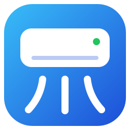

#  MirAIe Desktop

A desktop app (Avalonia 12, .NET 10, MVVM) for controlling Panasonic ACs that use the MirAIe app.
It's a port of the Home Assistant integration [rkzofficial/ha-miraie-ac](https://github.com/rkzofficial/ha-miraie-ac)
and the `miraie-ac` Python library it depends on.

## Download

Get the latest version from [Releases](https://github.com/ravibpatel/miraie-desktop/releases/latest). Each download is self-contained,
so you don't need to install .NET.

| Platform | File | First run |
|---|---|---|
| Windows | `MirAIe.Desktop-win-x64.exe` (`win-arm64` for ARM PCs) | Run it. If SmartScreen warns you, choose **More info → Run anyway**. |
| macOS | `MirAIe.Desktop-osx-arm64.zip` for Apple silicon, `osx-x64` for Intel Macs | Unzip it and move `MirAIe.app` to Applications. The app isn't notarized, so the first time you open it, macOS blocks it: go to **System Settings → Privacy & Security** and choose **Open Anyway**. |
| Linux | `MirAIe.Desktop-linux-x64.AppImage` (`linux-arm64` for ARM) | Make it executable with `chmod +x`, then run it. If your system has no FUSE, run it with `--appimage-extract-and-run`. |

## Run from source

```
dotnet run --project MirAIe.Desktop
```

Sign in the same way as in the MirAIe Android app: pick your country, then enter your mobile number and password.
The app sends the number in international format (for example `+919876543210`).
If your account was registered with an email address, choose **Use email instead**.

## Features

- Power, target temperature (16–30 °C), mode (cool/auto/dry/fan/heat) and fan speed (auto/quiet/low/medium/high)
- Presets (eco/boost/clean), Converti capacity modes, vertical and horizontal swing, display light
- Live state updates over MQTT, with automatic reconnect and token renewal
- Energy use for yesterday, the current week and the current month
- "Remember me" saves your username and password as one entry in the OS secret store, using
  [Microsoft.Identity.Client.Extensions.Msal](https://www.nuget.org/packages/Microsoft.Identity.Client.Extensions.Msal).
  Leaving it unchecked saves nothing.
  - Windows: a DPAPI-encrypted `credentials.bin` in `%LOCALAPPDATA%\MirAIe`
  - macOS: the Keychain
  - Linux: the Secret Service (GNOME Keyring or KWallet; needs `libsecret`)

  Signing out removes the password but keeps the username. If there's no usable credential store
  (for example Linux without a keyring), "Remember me" is hidden.

## Projects

| Project | Purpose |
|---|---|
| `MirAIe.Desktop` | Avalonia UI. `MainViewModel` switches between `LoginViewModel` and `DashboardViewModel`; each AC is an `AirConditionerViewModel`. |
| `MirAIe.Core` | MirAIe client with no UI dependencies. `MirAIeHub` handles sign-in and discovery, `AirConditioner` sends commands, `MirAIeBroker` keeps the MQTT connection. |
| `MirAIe.Core.Tests` | Tests for payloads, status parsing and energy date rules. |

## How it talks to MirAIe

1. `POST auth.miraie.in/.../userManagement/login` returns an access token.
2. `GET app.miraie.in/.../homeManagement/homes` lists devices and their MQTT topic. Only the first home is used, the same as the Python library.
3. `GET .../devices/{id}/mobile/status` returns the initial state.
4. MQTT over TLS to `mqtt.miraie.in:8883`, with the home id as username and the access token as password:
   - subscribe to `{topic}/status` and `{topic}/connectionStatus`
   - publish JSON commands such as `{"ki":1,"cnt":"an","sid":"1","acmd":"cool"}` to `{topic}/control`

Debug logs, including raw MQTT payloads, go to the Visual Studio **Output** window.
